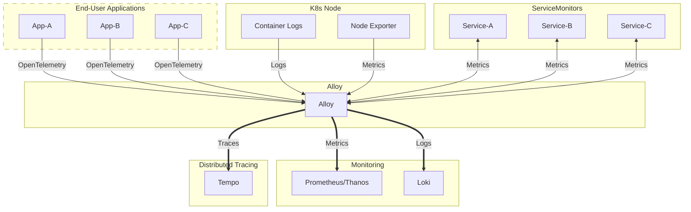

# Grafana Alloy

## Overview

[Grafana Alloy](https://grafana.com/docs/alloy/latest/), formerly known as
Grafana Agent, is Grafana's opinionated spin of the OpenTelemetry collector. It
combines many open-source projects in the cloud-native observability space with
the goal of being the only observability component necessary to collect and
distribute telemetry signals within a cluster.

## Big Bang Touchpoints

### Cortex Tenant remote write

The [Alloy → Cortex Tenant → Mimir example values](../../reference/configs/example/alloy-cortex-tenant-mimir-values.yaml)
show how to deploy Cortex Tenant as a custom package, select it as Alloy's
remote-write destination, enable both sides of the required network-policy
connections, and order the HelmReleases. The umbrella does not configure this
path automatically because Cortex Tenant is not a built-in package.

The example assumes Istio sidecars and uses Alloy's mounted Istio certificates
to scrape kube-state-metrics and node-exporter and to write to Cortex Tenant.
The example disables server certificate verification for these three TLS
connections because Istio workload certificates lack the Service DNS names or
Pod IP addresses Alloy uses. Traffic is encrypted, but Alloy does not verify
the server's identity. Use verifiable serving certificates and enable
verification where possible. For ambient or non-Istio deployments, configure
TLS for the destination and direct exporter scrapes where available. HTTP sends
metrics without transport encryption; use it only when that is acceptable for
your environment. Review the `extraConfig` override if you already provide
custom Alloy metrics pipelines.
Set `extraLabels.tenant` to the desired tenant; Cortex Tenant rejects series
without a tenant label by default. The example disables Prometheus while
retaining monitoring's exporters. With Prometheus disabled, the umbrella
disables its token-dependent control-plane ServiceMonitors by default; operators
who provide independent scrape credentials can enable them explicitly.

### Licensing

Grafana Alloy is open-source,
[licensed under Apache 2.0](https://github.com/grafana/alloy/blob/main/LICENSE).

### UI

While Grafana Alloy does expose a
[UI for visualizing its configuration status](https://grafana.com/docs/alloy/latest/troubleshoot/debug/),
it is not necessary for use and is not exposed by default within Big Bang.

### Storage

Grafana Alloy requires no storage itself, opting instead to push telemetry
signals to other cluster components like Loki and Tempo, which have their own
storage needs.

### Logging

Grafana Alloy writes its logs to stderr. These logs will be picked up by the
logging collector configured within the cluster.

### High Availability

Grafana Alloy supports multiple deployment modes with built-in clustering.
Depending on which features are enabled in the `k8s-monitoring` chart, Alloy
may be deployed as a `StatefulSet`, `DaemonSet`, or `Deployment`.

### Health Checks

Grafana Alloy is configured with standard liveness and readiness probes. In
addition to the health of Alloy itself, cluster administrators can view the UI
mentioned above for specific health statuses of individual Alloy
[components](https://grafana.com/docs/alloy/latest/get-started/components/).
