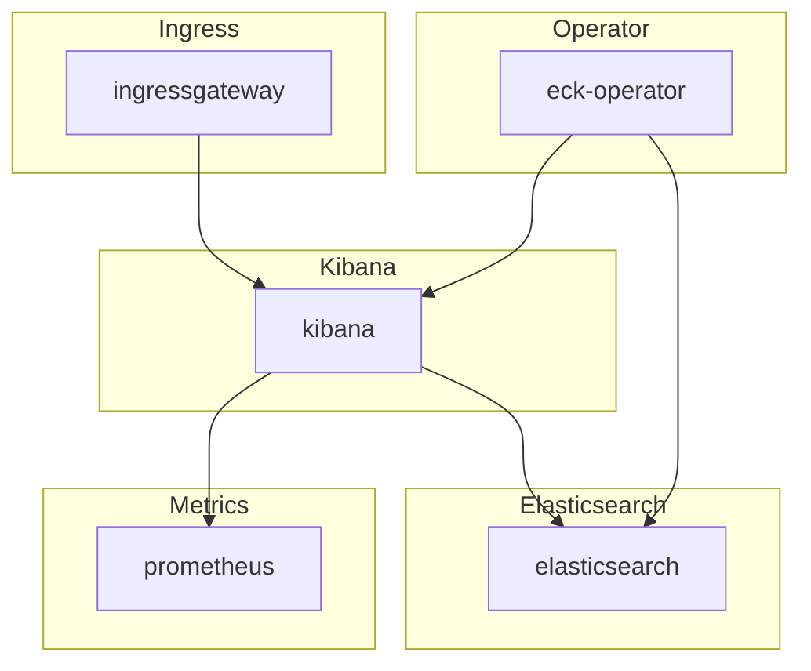

# Elasticsearch-Kibana

## Overview

[Elasticsearch-Kibana](https://www.elastic.co/elastic-stack) Elasticsearch is a search engine based on the Lucene library. It provides a distributed, multi-tenant-capable full-text search engine with an HTTP web interface and schema-free JSON documents. Kibana is a data visualization dashboard for Elasticsearch. It provides visualization capabilities on top of the content indexed on an Elasticsearch cluster. Users can create bar, line and scatter plots, or pie charts and maps on top of large volumes of data.

## Big Bang Touch Points



### Storage

Persistent storage for both Elasticsearch Master and Data nodes can be configured with the following values:

```yaml
packages:
  elasticsearchKibana:
    values:
      elasticsearch:
        master:
          persistence:
            storageClassName: ""
            size: 10Gi
        data:
          persistence:
            storageClassName: ""
            size: 20Gi
```

### Istio Configuration

Big Bang configures Kibana's Istio route when Istiod is enabled. Set the
platform domain and enable the package in the umbrella values:

```yaml
domain: dev.bigbang.mil
packages:
  istiod:
    enabled: true
  elasticsearchKibana:
    enabled: true
```

The umbrella generates the host `kibana.<domain>` and selects the package's
ingress gateway. Override the route beneath the `bb-common` subchart key:

```yaml
packages:
  elasticsearchKibana:
    values:
      bb-common:
        routes:
          inbound:
            kibana:
              hosts:
                - kibana.example.mil
```

## High Availability

This can be accomplished by increasing the "count" or number of replicas in each deployment in the stack:

```yaml
packages:
  elasticsearchKibana:
    values:
      kibana:
        count: 1
      elasticsearch:
        master:
          count: 3
        data:
          count: 4
```

## Single Sign On (SSO)

SSO integration for the eck stack requires a license (see below) and can be configured with the following values:

```yaml
packages:
  elasticsearchKibana:
    sso:
      # -- Toggle OIDC SSO for Kibana/Elasticsearch on and off.
      # Enabling this option will auto-create any required secrets.
      enabled: true
      # -- Elasticsearch/Kibana OIDC client ID
      client_id: "EXAMPLE_OIDC_CLIENT"
      # -- Elasticsearch/Kibana OIDC client secret
      client_secret: "EXAMPLE_OIDC_CLIENT_SECRET"
      # -- Optional OIDC claim pattern for the authenticated principal.
      claims_principal_pattern: ""
      # -- Optional additional scopes requested from the OIDC provider.
      requested_scopes: []
      # -- Optional OIDC signature algorithm.
      signature_algorithm: ""
```

## Licensing

Features like SSO integration, email/slack/Pagerduty alerting, FIPS 140-2 mode, encryption at rest, and more for the eck stack requires a platinum or enterprise license. Information about licensing and all features is available [here](https://www.elastic.co/pricing/). A Trial license can be enabled by setting `trial: true` in the below settings to enable a 30-day trial of enterprise settings.
Licensing can be configured with the following values:

```yaml
packages:
  elasticsearchKibana:
    license:
      trial: false
      keyJSON: |
        {"license":{"uid":....}}
```

## Health Checks

Licensed ECK comes with [built in Health monitoring for Kibana and Elasticsearch](https://www.elastic.co/guide/en/kibana/current/monitoring-kibana.html). This is called self-monitoring within the Kibana UI available at the Stack Monitoring settings `https://KIBANA_URL/app/monitoring`#.

Outside of the UI it is possible to check the health of Elasticsearch cluster via port-forward via doing the following:

```shell
kubectl get secrets -n logging logging-ek-es-elastic-user -o go-template='{{.data.elastic | base64decode}}'

kubectl port-forward svc/logging-ek-es-http -n logging 9200:9200

curl -ku "elastic:ELASTIC_PASSWORD" "https://localhost:9200/_cluster/health?pretty"
```
