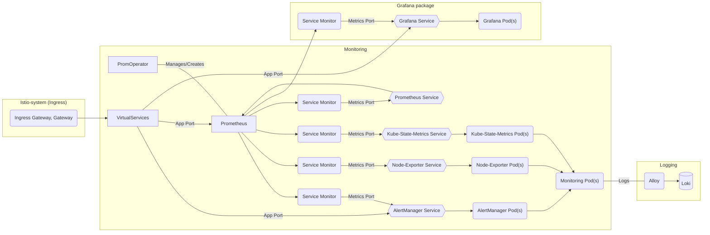

# Monitoring

## Overview

Monitoring in Bigbang is deployed using the upstream chart  [kube-prometheus-stack](https://github.com/prometheus-community/helm-charts/tree/main/charts/kube-prometheus-stack)

Installs the kube-prometheus stack, a collection of Kubernetes manifests, Grafana dashboards, and Prometheus rules combined with documentation and scripts to provide easy to operate end-to-end Kubernetes cluster monitoring with Prometheus using the Prometheus Operator.



## Upgrade Notices: bb-common subchart

Monitoring 91.4.1-bb.2 requires the paired umbrella wiring for bb-common subchart
mode. Move package overrides from `monitoring.values.istio`,
`monitoring.values.networkPolicies`, and `monitoring.values.routes` to
`monitoring.values.bb-common.istio`, `monitoring.values.bb-common.networkPolicies`,
and `monitoring.values.bb-common.routes`. With package configuration v1, use
`packages.monitoring` instead of `monitoring`.

Replace package `domain` and `upstream.domain` overrides with `global.domain`.
Remove package `istio.injection`; the umbrella controls namespace injection and
sets mesh mode in bb-common. Standalone chart users must explicitly enable each
inbound route and keep its service and port aligned with upstream overrides.
Custom route templates run in the bb-common scope and cannot read parent
`upstream` values.

Configure API-server egress through
`networkPolicies.egress.definitions.kubeAPI`. Monitoring no longer builds this
definition from `networkPolicies.controlPlaneCidr` or `networkPolicies.vpcCidr`.
`controlPlaneCidr` continues to control admission-webhook ingress.

Custom Istio resources belong in `bb-common.istio.serviceEntries.custom` and
`bb-common.istio.authorizationPolicies.custom`. Migrate legacy hardened custom
resource lists to these paths; the monitoring umbrella integration no longer
automatically translates them.
Ambient SSO enrollment and client policies now reference the rendered
`monitoring-waypoint` Gateway; update external policies that selected
`monitoring-monitoring-waypoint`.

## Big Bang Touchpoints

### UI

Alertmanager and Prometheus in the monitoring package have UIs. Big Bang deploys
Grafana as a separate, enabled-by-default `packages.grafana` package. Monitoring's
optional upstream Grafana is disabled by default; enabling it creates a separate
Grafana installation and requires independent routing and integration. The
default UIs are accessible through Istio when its gateway is enabled.

The examples below are **umbrella values**. Monitoring's upstream chart settings
belong under `packages.monitoring.values.upstream`; the separate Grafana
package's upstream settings belong under `packages.grafana.values.upstream`.
See the version-pinned [monitoring upstream values](https://github.com/prometheus-community/helm-charts/blob/kube-prometheus-stack-92.13.1/charts/kube-prometheus-stack/values.yaml)
and [Grafana package values](https://repo1.dso.mil/big-bang/product/packages/grafana/-/blob/14.0.1-bb.0/chart/values.yaml).

### Storage

#### Alertmanager

Persistent storage values for Alert Manager can be set/modified in the Big Bang chart:

```yaml
packages:
  monitoring:
    values:
      upstream:
        alertmanager:
          alertmanagerSpec:
            storage:
              volumeClaimTemplate:
                spec:
                  accessModes: ["ReadWriteOnce"]
                  resources:
                    requests:
                      storage: 50Gi
```

#### Prometheus-Operator

Persistent storage values for Prometheus-Operator can be set/modified in the Big Bang chart:

```yaml
packages:
  monitoring:
    values:
      upstream:
        prometheus:
          prometheusSpec:
            storageSpec:
              volumeClaimTemplate:
                spec:
                  accessModes: ["ReadWriteOnce"]
                  resources:
                    requests:
                      storage: 50Gi
```

#### Grafana

Enable persistent storage for the separate Grafana package. Select an appropriate
storage class for your environment if the default is unsuitable:

```yaml
packages:
  grafana:
    values:
      upstream:
        persistence:
          type: pvc
          enabled: true
          accessModes:
            - ReadWriteOnce
          size: 10Gi
          # annotations: {}
          finalizers:
            - kubernetes.io/pvc-protection
          # selectorLabels: {}
          # subPath: ""
          # existingClaim:
```

### Logging

Within the kube-prometheus-stack chart, you can customize both the LogFormat and LogLevel for the following components:
By default, Big Bang collects logs with Alloy and sends them to Loki.

#### Prometheus-Operator

LogFormat and LogLevel can be set for Prometheus-Operator via the following values in the Big Bang chart:

```yaml
packages:
  monitoring:
    values:
      upstream:
        prometheusOperator:
          logFormat: logfmt
          logLevel: info
```

#### Prometheus

LogFormat and LogLevel can be set for Prometheus via the following values in the Big Bang chart:

```yaml
packages:
  monitoring:
    values:
      upstream:
        prometheus:
          prometheusSpec:
            logFormat: logfmt
            logLevel: info
```

#### Alertmanager

LogFormat and LogLevel can be set for Alertmanager via the following values in the Big Bang chart:

```yaml
packages:
  monitoring:
    values:
      upstream:
        alertmanager:
          alertmanagerSpec:
            logFormat: logfmt
            logLevel: info
```

#### Grafana

Set logging for the separate Grafana package using these umbrella values:

```yaml
packages:
  grafana:
    values:
      upstream:
        grafana.ini:
          log:
            mode: console
```

## Single Sign on (SSO)

SSO can be configured for monitoring through Authservice, more info is included in the following documentation:
[Monitoring SSO Integration](https://repo1.dso.mil/big-bang/product/packages/monitoring/-/blob/main/docs/KEYCLOAK.md)

## Monitoring

Monitoring deployment has serviceMonitors enabled for

* core-dns
* kube-api-server
* kube-controller-manager
* kube-dns
* kube-etcd
* kube-proxy
* kube-scheduler
* kube-state-metrics
* kubelet
* node-exporter
* alert manager
* grafana
* prometheus
* prometheus-operator
* node-exporter

Note: Other packages are responsible for deploying Service Monitors for their components as needed.

### HA

Support for Prometheus and other apps within the package are being researched and section will be updated:

#### Alertmanager

High Availability can be accomplished by increasing the number of replicas for the deployment of Alertmanager;
```yaml
packages:
  monitoring:
    values:
      upstream:
        alertmanager:
          alertmanagerSpec:
            replicas: 3
```

#### Prometheus

Increase Prometheus replicas for availability. Replicas scrape independently;
use [Thanos](https://repo1.dso.mil/big-bang/product/packages/thanos/-/tree/main)
for a deduplicated query view and long-term object storage. Configure its object
store and network access separately; see the [Thanos test values](https://repo1.dso.mil/big-bang/product/packages/thanos/-/blob/main/tests/test-values.yaml)
for an example.
```yaml
packages:
  monitoring:
    values:
      upstream:
        prometheus:
          prometheusSpec:
            replicas: 3
```

#### Grafana

For the separate Grafana package, configure an external database (PostgreSQL or
MySQL) shared by the replicas. Supply credentials securely rather than in this
example. See Grafana's [database documentation](https://grafana.com/docs/grafana/latest/setup-grafana/configure-grafana/#database).
```yaml
packages:
  grafana:
    values:
      upstream:
        replicas: 3
        grafana.ini:
          database:
            type: postgres
            host: DATABASE_HOST:5432
            name: grafana
```

### Dependency Packages

When deploying BigBang, monitoring depends on gatekeeper/kyverno and istio being installed prior.

```yaml
  {{- if or .Values.packages.gatekeeper.enabled .Values.packages.istiod.enabled .Values.packages.kyvernoPolicies.enabled }}
  dependsOn:
  {{- if .Values.packages.istiod.enabled }}
    - name: istio
      namespace: {{ .Release.Namespace }}
  {{- end }}
  {{- if .Values.packages.gatekeeper.enabled }}
    - name: gatekeeper
      namespace: {{ .Release.Namespace }}
  {{- end }}
  {{- if .Values.packages.kyvernoPolicies.enabled }}
    - name: kyverno-policies
      namespace: {{ .Release.Namespace }}
  {{- end }}
  {{- end }}
```
